# Diccionario de Datos Relacional (Sección M2)

:::info Docs-as-Code — Derivado del Código Fuente
Este diccionario se genera automáticamente analizando los modelos SQLAlchemy en `backend/app/models/models.py`.
Se respeta estrictamente el estándar arquitectónico **INTEGER SERIAL** (ADR-002), sin uso de UUIDs como claves foráneas.
:::

**Total de tablas relacionales catalogadas:** 27

## Resumen Entidad-Relación (Mermaid ERD)

```mermaid
erDiagram
    BADGES ||--o{ USUARIOS_BADGES : "id_badge"
    CHECKPOINTS ||--o{ ASISTENCIA_DETALLES : "id_checkpoint"
    CURSOS ||--o{ BADGES : "id_curso_origen"
    CURSOS ||--o{ CERTIFICADOS : "id_curso"
    CURSOS ||--o{ INSCRIPCIONES_CURSOS : "id_curso"
    CURSOS ||--o{ LECCIONES : "id_curso"
    CURSOS ||--o{ POSTS_FORO : "id_curso"
    CURSOS ||--o{ RECURSOS : "id_curso"
    ESTADOS_REGISTRO ||--o{ ANUNCIOS : "id_estado"
    ESTADOS_REGISTRO ||--o{ ASISTENCIA_DETALLES : "id_estado"
    ESTADOS_REGISTRO ||--o{ AUSPICIADORES : "id_estado"
    ESTADOS_REGISTRO ||--o{ BADGES : "id_estado"
    ESTADOS_REGISTRO ||--o{ CERTIFICADOS : "id_estado"
    ESTADOS_REGISTRO ||--o{ CHECKPOINTS : "id_estado"
    ESTADOS_REGISTRO ||--o{ COMUNIDADES_ALIADAS : "id_estado"
    ESTADOS_REGISTRO ||--o{ CONFIGURACION_GLOBAL : "id_estado"
    ESTADOS_REGISTRO ||--o{ CURSOS : "id_estado"
    ESTADOS_REGISTRO ||--o{ ENTREGAS_TAREAS : "id_estado"
    ESTADOS_REGISTRO ||--o{ EVENTOS : "id_estado"
    ESTADOS_REGISTRO ||--o{ EVENTOS_PAGOS_QR : "id_estado"
    ESTADOS_REGISTRO ||--o{ INSCRIPCIONES_CURSOS : "id_estado"
    ESTADOS_REGISTRO ||--o{ INSCRIPCIONES_EVENTOS : "id_estado"
    ESTADOS_REGISTRO ||--o{ LECCIONES : "id_estado"
    ESTADOS_REGISTRO ||--o{ LOGS_SISTEMA : "id_estado"
    ESTADOS_REGISTRO ||--o{ PAGOS : "id_estado"
    ESTADOS_REGISTRO ||--o{ PEDIDOS : "id_estado"
    ESTADOS_REGISTRO ||--o{ PEDIDO_DETALLES : "id_estado"
    ESTADOS_REGISTRO ||--o{ POSTS_FORO : "id_estado"
    ESTADOS_REGISTRO ||--o{ PRODUCTOS : "id_estado"
    ESTADOS_REGISTRO ||--o{ RECURSOS : "id_estado"
```

---

### Tabla `estados_registro` (Modelo: `EstadoRegistro`)

| Nombre de Columna | Tipo de Dato | Clave | Nullable | Restricciones / Notas |
|---|---|---|---|---|
| `id_estado` | `INTEGER` | **PK** | SÍ | PK (autoincrement) |
| `nombre_estado` | `VARCHAR` | **-** | **NO** | unique |
| `descripcion` | `TEXT` | **-** | SÍ | - |

### Tabla `usuarios` (Modelo: `Usuario`) `AuditMixin` `EstadoLifecycle`

| Nombre de Columna | Tipo de Dato | Clave | Nullable | Restricciones / Notas |
|---|---|---|---|---|
| `id_usuario` | `INTEGER` | **PK** | SÍ | index, PK (autoincrement) |
| `nombres` | `STRING` | **-** | SÍ | - |
| `apellidos` | `STRING` | **-** | SÍ | - |
| `alias` | `STRING` | **-** | SÍ | - |
| `foto_url` | `STRING` | **-** | SÍ | - |
| `preferencia_tema` | `STRING` | **-** | SÍ | default=dark |
| `correo` | `STRING` | **-** | SÍ | unique, index |
| `password_hash` | `TEXT` | **-** | SÍ | - |
| `rol` | `STRING` | **-** | SÍ | default=MIEMBRO |
| `fecha_registro` | `DATETIME` | **-** | SÍ | default=utcnow |
| `bio` | `TEXT` | **-** | SÍ | - |
| `institucion` | `STRING` | **-** | SÍ | - |
| `estudia_en` | `STRING` | **-** | SÍ | - |
| `tipo_entidad` | `STRING` | **-** | SÍ | default=Estudiante |
| `pais` | `STRING` | **-** | SÍ | default=Bolivia |
| `departamento` | `STRING` | **-** | SÍ | - |
| `linkedin_url` | `STRING` | **-** | SÍ | - |
| `github_url` | `STRING` | **-** | SÍ | - |
| `facebook_url` | `STRING` | **-** | SÍ | - |
| `instagram_url` | `STRING` | **-** | SÍ | - |
| `tiktok_url` | `STRING` | **-** | SÍ | - |
| `learning_path_url` | `STRING` | **-** | SÍ | - |
| `perfil_publico` | `BOOLEAN` | **-** | SÍ | default=True |
| `activo` | `BOOLEAN` | **-** | SÍ | default=True |
| `es_nuevo` | `BOOLEAN` | **-** | SÍ | default=True |
| `reset_token` | `STRING` | **-** | SÍ | - |
| `reset_token_exp` | `DATETIME` | **-** | SÍ | - |
| `creado_por` | `INTEGER` | **FK** | SÍ | AuditMixin FK |
| `fecha_creacion` | `DATETIME` | **-** | SÍ | AuditMixin default=utcnow |
| `modificado_por` | `INTEGER` | **FK** | SÍ | AuditMixin FK |
| `fecha_modificacion` | `DATETIME` | **-** | SÍ | AuditMixin |
| `id_estado` | `INTEGER` | **FK** | **NO** | Lifecycle default=2 |
| `fecha_modificacion_estado` | `DATETIME` | **-** | SÍ | Lifecycle |

### Tabla `speakers` (Modelo: `Speaker`) `AuditMixin` `EstadoLifecycle`

| Nombre de Columna | Tipo de Dato | Clave | Nullable | Restricciones / Notas |
|---|---|---|---|---|
| `id_speaker` | `INTEGER` | **PK** | SÍ | index, PK (autoincrement) |
| `nombre` | `STRING` | **-** | SÍ | - |
| `bio` | `TEXT` | **-** | SÍ | - |
| `trayectoria` | `TEXT` | **-** | SÍ | - |
| `foto_url` | `STRING` | **-** | SÍ | - |
| `trabajo_actual` | `STRING` | **-** | SÍ | - |
| `linkedin_url` | `STRING` | **-** | SÍ | - |
| `twitter_url` | `STRING` | **-** | SÍ | - |
| `facebook_url` | `STRING` | **-** | SÍ | - |
| `instagram_url` | `STRING` | **-** | SÍ | - |
| `correo_contacto` | `STRING` | **-** | SÍ | - |
| `whatsapp_contacto` | `STRING` | **-** | SÍ | - |
| `creado_por` | `INTEGER` | **FK** | SÍ | AuditMixin FK |
| `fecha_creacion` | `DATETIME` | **-** | SÍ | AuditMixin default=utcnow |
| `modificado_por` | `INTEGER` | **FK** | SÍ | AuditMixin FK |
| `fecha_modificacion` | `DATETIME` | **-** | SÍ | AuditMixin |
| `id_estado` | `INTEGER` | **FK** | **NO** | Lifecycle default=2 |
| `fecha_modificacion_estado` | `DATETIME` | **-** | SÍ | Lifecycle |

### Tabla `auspiciadores` (Modelo: `Auspiciador`) `AuditMixin` `EstadoLifecycle`

| Nombre de Columna | Tipo de Dato | Clave | Nullable | Restricciones / Notas |
|---|---|---|---|---|
| `id_auspiciador` | `INTEGER` | **PK** | SÍ | index, PK (autoincrement) |
| `nombre` | `STRING` | **-** | SÍ | - |
| `logo_url` | `STRING` | **-** | SÍ | - |
| `sitio_web` | `STRING` | **-** | SÍ | - |
| `tipo` | `STRING` | **-** | SÍ | default=GENERAL |
| `correo_contacto` | `STRING` | **-** | SÍ | - |
| `whatsapp_contacto` | `STRING` | **-** | SÍ | - |
| `creado_por` | `INTEGER` | **FK** | SÍ | AuditMixin FK |
| `fecha_creacion` | `DATETIME` | **-** | SÍ | AuditMixin default=utcnow |
| `modificado_por` | `INTEGER` | **FK** | SÍ | AuditMixin FK |
| `fecha_modificacion` | `DATETIME` | **-** | SÍ | AuditMixin |
| `id_estado` | `INTEGER` | **FK** | **NO** | Lifecycle default=2 |
| `fecha_modificacion_estado` | `DATETIME` | **-** | SÍ | Lifecycle |

### Tabla `comunidades_aliadas` (Modelo: `ComunidadAliada`) `AuditMixin` `EstadoLifecycle`

| Nombre de Columna | Tipo de Dato | Clave | Nullable | Restricciones / Notas |
|---|---|---|---|---|
| `id_comunidad` | `INTEGER` | **PK** | SÍ | index, PK (autoincrement) |
| `nombre` | `STRING` | **-** | SÍ | - |
| `descripcion` | `TEXT` | **-** | SÍ | - |
| `logo_url` | `STRING` | **-** | SÍ | - |
| `link_contacto` | `STRING` | **-** | SÍ | - |
| `correo_contacto` | `STRING` | **-** | SÍ | - |
| `whatsapp_contacto` | `STRING` | **-** | SÍ | - |
| `creado_por` | `INTEGER` | **FK** | SÍ | AuditMixin FK |
| `fecha_creacion` | `DATETIME` | **-** | SÍ | AuditMixin default=utcnow |
| `modificado_por` | `INTEGER` | **FK** | SÍ | AuditMixin FK |
| `fecha_modificacion` | `DATETIME` | **-** | SÍ | AuditMixin |
| `id_estado` | `INTEGER` | **FK** | **NO** | Lifecycle default=2 |
| `fecha_modificacion_estado` | `DATETIME` | **-** | SÍ | Lifecycle |

### Tabla `configuracion_global` (Modelo: `ConfiguracionGlobal`) `AuditMixin` `EstadoLifecycle`

| Nombre de Columna | Tipo de Dato | Clave | Nullable | Restricciones / Notas |
|---|---|---|---|---|
| `id_config` | `INTEGER` | **PK** | SÍ | PK (autoincrement) |
| `clave` | `STRING` | **-** | SÍ | unique |
| `valor` | `TEXT` | **-** | SÍ | - |
| `descripcion` | `STRING` | **-** | SÍ | - |
| `creado_por` | `INTEGER` | **FK** | SÍ | AuditMixin FK |
| `fecha_creacion` | `DATETIME` | **-** | SÍ | AuditMixin default=utcnow |
| `modificado_por` | `INTEGER` | **FK** | SÍ | AuditMixin FK |
| `fecha_modificacion` | `DATETIME` | **-** | SÍ | AuditMixin |
| `id_estado` | `INTEGER` | **FK** | **NO** | Lifecycle default=2 |
| `fecha_modificacion_estado` | `DATETIME` | **-** | SÍ | Lifecycle |

### Tabla `badges` (Modelo: `Badge`) `AuditMixin` `EstadoLifecycle`

| Nombre de Columna | Tipo de Dato | Clave | Nullable | Restricciones / Notas |
|---|---|---|---|---|
| `id_badge` | `INTEGER` | **PK** | SÍ | index, PK (autoincrement) |
| `nombre_badge` | `STRING` | **-** | SÍ | - |
| `descripcion` | `TEXT` | **-** | SÍ | - |
| `imagen_url` | `TEXT` | **-** | SÍ | - |
| `id_evento_origen` | `INTEGER` | **FK** | SÍ | FK -> eventos.id_evento |
| `id_curso_origen` | `INTEGER` | **FK** | SÍ | FK -> cursos.id_curso |
| `puntos` | `INTEGER` | **-** | SÍ | default=10 |
| `requisito_nivel` | `STRING` | **-** | SÍ | default=Beginner |
| `creado_por` | `INTEGER` | **FK** | SÍ | AuditMixin FK |
| `fecha_creacion` | `DATETIME` | **-** | SÍ | AuditMixin default=utcnow |
| `modificado_por` | `INTEGER` | **FK** | SÍ | AuditMixin FK |
| `fecha_modificacion` | `DATETIME` | **-** | SÍ | AuditMixin |
| `id_estado` | `INTEGER` | **FK** | **NO** | Lifecycle default=2 |
| `fecha_modificacion_estado` | `DATETIME` | **-** | SÍ | Lifecycle |

### Tabla `usuarios_badges` (Modelo: `UsuarioBadge`) `AuditMixin` `EstadoLifecycle`

| Nombre de Columna | Tipo de Dato | Clave | Nullable | Restricciones / Notas |
|---|---|---|---|---|
| `id_usuario_badge` | `INTEGER` | **PK** | SÍ | index, PK (autoincrement) |
| `id_usuario` | `INTEGER` | **FK** | SÍ | FK -> usuarios.id_usuario |
| `id_badge` | `INTEGER` | **FK** | SÍ | FK -> badges.id_badge |
| `fecha_obtencion` | `DATETIME` | **-** | SÍ | default=utcnow |
| `creado_por` | `INTEGER` | **FK** | SÍ | AuditMixin FK |
| `fecha_creacion` | `DATETIME` | **-** | SÍ | AuditMixin default=utcnow |
| `modificado_por` | `INTEGER` | **FK** | SÍ | AuditMixin FK |
| `fecha_modificacion` | `DATETIME` | **-** | SÍ | AuditMixin |
| `id_estado` | `INTEGER` | **FK** | **NO** | Lifecycle default=2 |
| `fecha_modificacion_estado` | `DATETIME` | **-** | SÍ | Lifecycle |

### Tabla `productos` (Modelo: `Producto`) `AuditMixin` `EstadoLifecycle`

| Nombre de Columna | Tipo de Dato | Clave | Nullable | Restricciones / Notas |
|---|---|---|---|---|
| `id_producto` | `INTEGER` | **PK** | SÍ | index, PK (autoincrement) |
| `nombre` | `VARCHAR` | **-** | SÍ | - |
| `descripcion` | `TEXT` | **-** | SÍ | - |
| `precio` | `VARCHAR` | **-** | SÍ | default=0 |
| `stock` | `INTEGER` | **-** | SÍ | default=0 |
| `es_kit_evento` | `BOOLEAN` | **-** | SÍ | default=False |
| `imagen_url` | `TEXT` | **-** | SÍ | - |
| `categoria` | `STRING` | **-** | SÍ | default=SOUVENIR |
| `activo` | `BOOLEAN` | **-** | SÍ | default=True |
| `creado_por` | `INTEGER` | **FK** | SÍ | AuditMixin FK |
| `fecha_creacion` | `DATETIME` | **-** | SÍ | AuditMixin default=utcnow |
| `modificado_por` | `INTEGER` | **FK** | SÍ | AuditMixin FK |
| `fecha_modificacion` | `DATETIME` | **-** | SÍ | AuditMixin |
| `id_estado` | `INTEGER` | **FK** | **NO** | Lifecycle default=2 |
| `fecha_modificacion_estado` | `DATETIME` | **-** | SÍ | Lifecycle |

### Tabla `pedidos` (Modelo: `Pedido`) `AuditMixin` `EstadoLifecycle`

| Nombre de Columna | Tipo de Dato | Clave | Nullable | Restricciones / Notas |
|---|---|---|---|---|
| `id_pedido` | `INTEGER` | **PK** | SÍ | index, PK (autoincrement) |
| `id_usuario` | `INTEGER` | **FK** | SÍ | index, FK -> usuarios.id_usuario |
| `id_pago` | `INTEGER` | **FK** | SÍ | index, FK -> pagos.id_pago |
| `estado` | `STRING` | **-** | SÍ | default=PENDIENTE |
| `fecha_pedido` | `DATETIME` | **-** | SÍ | default=utcnow |
| `total` | `VARCHAR` | **-** | SÍ | default=0 |
| `creado_por` | `INTEGER` | **FK** | SÍ | AuditMixin FK |
| `fecha_creacion` | `DATETIME` | **-** | SÍ | AuditMixin default=utcnow |
| `modificado_por` | `INTEGER` | **FK** | SÍ | AuditMixin FK |
| `fecha_modificacion` | `DATETIME` | **-** | SÍ | AuditMixin |
| `id_estado` | `INTEGER` | **FK** | **NO** | Lifecycle default=2 |
| `fecha_modificacion_estado` | `DATETIME` | **-** | SÍ | Lifecycle |

### Tabla `pedido_detalles` (Modelo: `PedidoDetalle`) `EstadoLifecycle`

| Nombre de Columna | Tipo de Dato | Clave | Nullable | Restricciones / Notas |
|---|---|---|---|---|
| `id_detalle` | `INTEGER` | **PK** | SÍ | index, PK (autoincrement) |
| `id_pedido` | `INTEGER` | **FK** | SÍ | index, FK -> pedidos.id_pedido |
| `id_producto` | `INTEGER` | **FK** | SÍ | index, FK -> productos.id_producto |
| `cantidad` | `INTEGER` | **-** | SÍ | default=1 |
| `precio_unitario` | `VARCHAR` | **-** | SÍ | - |
| `id_estado` | `INTEGER` | **FK** | **NO** | Lifecycle default=2 |
| `fecha_modificacion_estado` | `DATETIME` | **-** | SÍ | Lifecycle |

### Tabla `eventos` (Modelo: `Evento`) `AuditMixin` `EstadoLifecycle`

| Nombre de Columna | Tipo de Dato | Clave | Nullable | Restricciones / Notas |
|---|---|---|---|---|
| `id_evento` | `INTEGER` | **PK** | SÍ | index, PK (autoincrement) |
| `titulo` | `STRING` | **-** | SÍ | - |
| `descripcion` | `TEXT` | **-** | SÍ | - |
| `tipo_evento` | `STRING` | **-** | SÍ | default=CONFERENCIA |
| `fecha_inicio` | `DATETIME` | **-** | SÍ | - |
| `fecha_fin` | `DATETIME` | **-** | SÍ | - |
| `hora_inicio` | `STRING` | **-** | SÍ | - |
| `hora_fin` | `STRING` | **-** | SÍ | - |
| `modalidad` | `STRING` | **-** | SÍ | - |
| `ubicacion` | `STRING` | **-** | SÍ | - |
| `link_mapas` | `STRING` | **-** | SÍ | - |
| `agenda` | `TEXT` | **-** | SÍ | - |
| `capacidad_max` | `INTEGER` | **-** | SÍ | - |
| `estado` | `STRING` | **-** | SÍ | default=PROGRAMADO |
| `imagen_url` | `STRING` | **-** | SÍ | - |
| `refrigerio_incluido` | `BOOLEAN` | **-** | SÍ | default=False |
| `incluidos` | `TEXT` | **-** | SÍ | - |
| `token_qr` | `STRING` | **-** | SÍ | - |
| `id_organizador` | `INTEGER` | **FK** | SÍ | index, FK -> usuarios.id_usuario |
| `creado_por` | `INTEGER` | **FK** | SÍ | AuditMixin FK |
| `fecha_creacion` | `DATETIME` | **-** | SÍ | AuditMixin default=utcnow |
| `modificado_por` | `INTEGER` | **FK** | SÍ | AuditMixin FK |
| `fecha_modificacion` | `DATETIME` | **-** | SÍ | AuditMixin |
| `id_estado` | `INTEGER` | **FK** | **NO** | Lifecycle default=2 |
| `fecha_modificacion_estado` | `DATETIME` | **-** | SÍ | Lifecycle |

### Tabla `inscripciones_eventos` (Modelo: `InscripcionEvento`) `AuditMixin` `EstadoLifecycle`

| Nombre de Columna | Tipo de Dato | Clave | Nullable | Restricciones / Notas |
|---|---|---|---|---|
| `id_inscripcion` | `INTEGER` | **PK** | SÍ | index, PK (autoincrement) |
| `id_usuario` | `INTEGER` | **FK** | SÍ | index, FK -> usuarios.id_usuario |
| `id_evento` | `INTEGER` | **FK** | SÍ | index, FK -> eventos.id_evento |
| `fecha_inscripcion` | `DATETIME` | **-** | SÍ | default=utcnow |
| `estado_inscripcion` | `STRING` | **-** | SÍ | default=PENDIENTE |
| `codigo_qr` | `STRING` | **-** | SÍ | unique |
| `asistio` | `BOOLEAN` | **-** | SÍ | default=False |
| `fecha_validacion` | `DATETIME` | **-** | SÍ | - |
| `id_pago` | `INTEGER` | **FK** | SÍ | index, FK -> pagos.id_pago |
| `creado_por` | `INTEGER` | **FK** | SÍ | AuditMixin FK |
| `fecha_creacion` | `DATETIME` | **-** | SÍ | AuditMixin default=utcnow |
| `modificado_por` | `INTEGER` | **FK** | SÍ | AuditMixin FK |
| `fecha_modificacion` | `DATETIME` | **-** | SÍ | AuditMixin |
| `id_estado` | `INTEGER` | **FK** | **NO** | Lifecycle default=2 |
| `fecha_modificacion_estado` | `DATETIME` | **-** | SÍ | Lifecycle |

### Tabla `checkpoints` (Modelo: `Checkpoint`) `AuditMixin` `EstadoLifecycle`

| Nombre de Columna | Tipo de Dato | Clave | Nullable | Restricciones / Notas |
|---|---|---|---|---|
| `id_checkpoint` | `INTEGER` | **PK** | SÍ | index, PK (autoincrement) |
| `id_evento` | `INTEGER` | **FK** | SÍ | index, FK -> eventos.id_evento |
| `nombre_checkpoint` | `STRING` | **-** | SÍ | - |
| `hora_apertura` | `DATETIME` | **-** | SÍ | - |
| `hora_cierre` | `DATETIME` | **-** | SÍ | - |
| `tipo_checkpoint` | `STRING` | **-** | SÍ | - |
| `orden` | `INTEGER` | **-** | SÍ | - |
| `activo` | `BOOLEAN` | **-** | SÍ | default=True |
| `creado_por` | `INTEGER` | **FK** | SÍ | AuditMixin FK |
| `fecha_creacion` | `DATETIME` | **-** | SÍ | AuditMixin default=utcnow |
| `modificado_por` | `INTEGER` | **FK** | SÍ | AuditMixin FK |
| `fecha_modificacion` | `DATETIME` | **-** | SÍ | AuditMixin |
| `id_estado` | `INTEGER` | **FK** | **NO** | Lifecycle default=2 |
| `fecha_modificacion_estado` | `DATETIME` | **-** | SÍ | Lifecycle |

### Tabla `asistencia_detalles` (Modelo: `AsistenciaDetalle`) `AuditMixin` `EstadoLifecycle`

| Nombre de Columna | Tipo de Dato | Clave | Nullable | Restricciones / Notas |
|---|---|---|---|---|
| `id_asistencia` | `INTEGER` | **PK** | SÍ | index, PK (autoincrement) |
| `id_inscripcion` | `INTEGER` | **FK** | SÍ | index, FK -> inscripciones_eventos.id_inscripcion |
| `id_checkpoint` | `INTEGER` | **FK** | SÍ | index, FK -> checkpoints.id_checkpoint |
| `fecha_escaneo` | `DATETIME` | **-** | SÍ | default=utcnow |
| `escaneado_por` | `INTEGER` | **FK** | SÍ | index, FK -> usuarios.id_usuario |
| `creado_por` | `INTEGER` | **FK** | SÍ | AuditMixin FK |
| `fecha_creacion` | `DATETIME` | **-** | SÍ | AuditMixin default=utcnow |
| `modificado_por` | `INTEGER` | **FK** | SÍ | AuditMixin FK |
| `fecha_modificacion` | `DATETIME` | **-** | SÍ | AuditMixin |
| `id_estado` | `INTEGER` | **FK** | **NO** | Lifecycle default=2 |
| `fecha_modificacion_estado` | `DATETIME` | **-** | SÍ | Lifecycle |

### Tabla `cursos` (Modelo: `Curso`) `AuditMixin` `EstadoLifecycle`

| Nombre de Columna | Tipo de Dato | Clave | Nullable | Restricciones / Notas |
|---|---|---|---|---|
| `id_curso` | `INTEGER` | **PK** | SÍ | index, PK (autoincrement) |
| `nombre_curso` | `STRING` | **-** | SÍ | - |
| `descripcion` | `TEXT` | **-** | SÍ | - |
| `horas_academicas` | `INTEGER` | **-** | SÍ | - |
| `estado` | `STRING` | **-** | SÍ | default=ACTIVO |
| `imagen_url` | `STRING` | **-** | SÍ | - |
| `id_instructor` | `INTEGER` | **FK** | SÍ | index, FK -> usuarios.id_usuario |
| `es_ms_learning` | `BOOLEAN` | **-** | SÍ | default=False |
| `external_url` | `STRING` | **-** | SÍ | - |
| `uid_ms` | `STRING` | **-** | SÍ | - |
| `creado_por` | `INTEGER` | **FK** | SÍ | AuditMixin FK |
| `fecha_creacion` | `DATETIME` | **-** | SÍ | AuditMixin default=utcnow |
| `modificado_por` | `INTEGER` | **FK** | SÍ | AuditMixin FK |
| `fecha_modificacion` | `DATETIME` | **-** | SÍ | AuditMixin |
| `id_estado` | `INTEGER` | **FK** | **NO** | Lifecycle default=2 |
| `fecha_modificacion_estado` | `DATETIME` | **-** | SÍ | Lifecycle |

### Tabla `lecciones` (Modelo: `Leccion`) `AuditMixin` `EstadoLifecycle`

| Nombre de Columna | Tipo de Dato | Clave | Nullable | Restricciones / Notas |
|---|---|---|---|---|
| `id_leccion` | `INTEGER` | **PK** | SÍ | index, PK (autoincrement) |
| `id_curso` | `INTEGER` | **FK** | SÍ | FK -> cursos.id_curso |
| `titulo` | `STRING` | **-** | SÍ | - |
| `contenido_video_url` | `STRING` | **-** | SÍ | - |
| `contenido_texto` | `TEXT` | **-** | SÍ | - |
| `orden` | `INTEGER` | **-** | SÍ | default=1 |
| `creado_por` | `INTEGER` | **FK** | SÍ | AuditMixin FK |
| `fecha_creacion` | `DATETIME` | **-** | SÍ | AuditMixin default=utcnow |
| `modificado_por` | `INTEGER` | **FK** | SÍ | AuditMixin FK |
| `fecha_modificacion` | `DATETIME` | **-** | SÍ | AuditMixin |
| `id_estado` | `INTEGER` | **FK** | **NO** | Lifecycle default=2 |
| `fecha_modificacion_estado` | `DATETIME` | **-** | SÍ | Lifecycle |

### Tabla `tareas` (Modelo: `Tarea`) `AuditMixin` `EstadoLifecycle`

| Nombre de Columna | Tipo de Dato | Clave | Nullable | Restricciones / Notas |
|---|---|---|---|---|
| `id_tarea` | `INTEGER` | **PK** | SÍ | index, PK (autoincrement) |
| `id_leccion` | `INTEGER` | **FK** | SÍ | FK -> lecciones.id_leccion |
| `titulo` | `STRING` | **-** | SÍ | - |
| `instrucciones` | `TEXT` | **-** | SÍ | - |
| `puntos_max` | `INTEGER` | **-** | SÍ | default=100 |
| `fecha_entrega_limite` | `DATETIME` | **-** | SÍ | - |
| `archivo_adjunto_url` | `STRING` | **-** | SÍ | - |
| `creado_por` | `INTEGER` | **FK** | SÍ | AuditMixin FK |
| `fecha_creacion` | `DATETIME` | **-** | SÍ | AuditMixin default=utcnow |
| `modificado_por` | `INTEGER` | **FK** | SÍ | AuditMixin FK |
| `fecha_modificacion` | `DATETIME` | **-** | SÍ | AuditMixin |
| `id_estado` | `INTEGER` | **FK** | **NO** | Lifecycle default=2 |
| `fecha_modificacion_estado` | `DATETIME` | **-** | SÍ | Lifecycle |

### Tabla `entregas_tareas` (Modelo: `EntregaTarea`) `AuditMixin` `EstadoLifecycle`

| Nombre de Columna | Tipo de Dato | Clave | Nullable | Restricciones / Notas |
|---|---|---|---|---|
| `id_entrega` | `INTEGER` | **PK** | SÍ | index, PK (autoincrement) |
| `id_tarea` | `INTEGER` | **FK** | SÍ | FK -> tareas.id_tarea |
| `id_usuario` | `INTEGER` | **FK** | SÍ | FK -> usuarios.id_usuario |
| `archivo_url` | `STRING` | **-** | SÍ | - |
| `comentario_alumno` | `TEXT` | **-** | SÍ | - |
| `nota` | `INTEGER` | **-** | SÍ | - |
| `comentario_docente` | `TEXT` | **-** | SÍ | - |
| `fecha_envio` | `DATETIME` | **-** | SÍ | default=utcnow |
| `creado_por` | `INTEGER` | **FK** | SÍ | AuditMixin FK |
| `fecha_creacion` | `DATETIME` | **-** | SÍ | AuditMixin default=utcnow |
| `modificado_por` | `INTEGER` | **FK** | SÍ | AuditMixin FK |
| `fecha_modificacion` | `DATETIME` | **-** | SÍ | AuditMixin |
| `id_estado` | `INTEGER` | **FK** | **NO** | Lifecycle default=2 |
| `fecha_modificacion_estado` | `DATETIME` | **-** | SÍ | Lifecycle |

### Tabla `posts_foro` (Modelo: `PostForo`) `AuditMixin` `EstadoLifecycle`

| Nombre de Columna | Tipo de Dato | Clave | Nullable | Restricciones / Notas |
|---|---|---|---|---|
| `id_post` | `INTEGER` | **PK** | SÍ | index, PK (autoincrement) |
| `id_curso` | `INTEGER` | **FK** | SÍ | FK -> cursos.id_curso |
| `id_usuario` | `INTEGER` | **FK** | SÍ | FK -> usuarios.id_usuario |
| `mensaje` | `TEXT` | **-** | SÍ | - |
| `es_pregunta_docente` | `BOOLEAN` | **-** | SÍ | default=False |
| `creado_por` | `INTEGER` | **FK** | SÍ | AuditMixin FK |
| `fecha_creacion` | `DATETIME` | **-** | SÍ | AuditMixin default=utcnow |
| `modificado_por` | `INTEGER` | **FK** | SÍ | AuditMixin FK |
| `fecha_modificacion` | `DATETIME` | **-** | SÍ | AuditMixin |
| `id_estado` | `INTEGER` | **FK** | **NO** | Lifecycle default=2 |
| `fecha_modificacion_estado` | `DATETIME` | **-** | SÍ | Lifecycle |

### Tabla `inscripciones_cursos` (Modelo: `InscripcionCurso`) `AuditMixin` `EstadoLifecycle`

| Nombre de Columna | Tipo de Dato | Clave | Nullable | Restricciones / Notas |
|---|---|---|---|---|
| `id_inscripcion_curso` | `INTEGER` | **PK** | SÍ | index, PK (autoincrement) |
| `id_usuario` | `INTEGER` | **FK** | SÍ | index, FK -> usuarios.id_usuario |
| `id_curso` | `INTEGER` | **FK** | SÍ | index, FK -> cursos.id_curso |
| `fecha_inscripcion` | `DATETIME` | **-** | SÍ | default=utcnow |
| `progreso` | `INTEGER` | **-** | SÍ | default=0 |
| `nota_final` | `VARCHAR` | **-** | SÍ | - |
| `finalizado` | `BOOLEAN` | **-** | SÍ | default=False |
| `id_pago` | `INTEGER` | **FK** | SÍ | index, FK -> pagos.id_pago |
| `estado_inscripcion` | `STRING` | **-** | SÍ | default=PENDIENTE |
| `creado_por` | `INTEGER` | **FK** | SÍ | AuditMixin FK |
| `fecha_creacion` | `DATETIME` | **-** | SÍ | AuditMixin default=utcnow |
| `modificado_por` | `INTEGER` | **FK** | SÍ | AuditMixin FK |
| `fecha_modificacion` | `DATETIME` | **-** | SÍ | AuditMixin |
| `id_estado` | `INTEGER` | **FK** | **NO** | Lifecycle default=2 |
| `fecha_modificacion_estado` | `DATETIME` | **-** | SÍ | Lifecycle |

### Tabla `pagos` (Modelo: `Pago`) `AuditMixin` `EstadoLifecycle`

| Nombre de Columna | Tipo de Dato | Clave | Nullable | Restricciones / Notas |
|---|---|---|---|---|
| `id_pago` | `INTEGER` | **PK** | SÍ | index, PK (autoincrement) |
| `id_usuario` | `INTEGER` | **FK** | SÍ | index, FK -> usuarios.id_usuario |
| `monto` | `VARCHAR` | **-** | SÍ | - |
| `fecha_pago` | `DATETIME` | **-** | SÍ | default=utcnow |
| `metodo_pago` | `STRING` | **-** | SÍ | - |
| `estado_pago` | `STRING` | **-** | SÍ | default=PENDIENTE |
| `comprobante_url` | `TEXT` | **-** | SÍ | - |
| `id_referencia` | `INTEGER` | **-** | SÍ | - |
| `tipo_referencia` | `STRING` | **-** | SÍ | - |
| `validado_por` | `INTEGER` | **FK** | SÍ | index, FK -> usuarios.id_usuario |
| `url_comprobante` | `STRING` | **-** | SÍ | - |
| `fecha_validacion` | `DATETIME` | **-** | SÍ | - |
| `notas_admin` | `TEXT` | **-** | SÍ | - |
| `porcentaje_ocr` | `VARCHAR` | **-** | SÍ | - |
| `texto_ocr` | `TEXT` | **-** | SÍ | - |
| `creado_por` | `INTEGER` | **FK** | SÍ | AuditMixin FK |
| `fecha_creacion` | `DATETIME` | **-** | SÍ | AuditMixin default=utcnow |
| `modificado_por` | `INTEGER` | **FK** | SÍ | AuditMixin FK |
| `fecha_modificacion` | `DATETIME` | **-** | SÍ | AuditMixin |
| `id_estado` | `INTEGER` | **FK** | **NO** | Lifecycle default=2 |
| `fecha_modificacion_estado` | `DATETIME` | **-** | SÍ | Lifecycle |

### Tabla `logs_sistema` (Modelo: `LogSistema`) `EstadoLifecycle`

| Nombre de Columna | Tipo de Dato | Clave | Nullable | Restricciones / Notas |
|---|---|---|---|---|
| `id_log` | `INTEGER` | **PK** | SÍ | index, PK (autoincrement) |
| `id_admin` | `INTEGER` | **FK** | SÍ | FK -> usuarios.id_usuario |
| `accion` | `STRING` | **-** | SÍ | - |
| `tabla_afectada` | `STRING` | **-** | SÍ | - |
| `id_registro_afectado` | `INTEGER` | **-** | SÍ | - |
| `valor_anterior` | `TEXT` | **-** | SÍ | - |
| `valor_nuevo` | `TEXT` | **-** | SÍ | - |
| `fecha_hora` | `DATETIME` | **-** | SÍ | default=utcnow |
| `ip_direccion` | `STRING` | **-** | SÍ | - |
| `id_estado` | `INTEGER` | **FK** | **NO** | Lifecycle default=2 |
| `fecha_modificacion_estado` | `DATETIME` | **-** | SÍ | Lifecycle |

### Tabla `certificados` (Modelo: `Certificado`) `AuditMixin` `EstadoLifecycle`

| Nombre de Columna | Tipo de Dato | Clave | Nullable | Restricciones / Notas |
|---|---|---|---|---|
| `id_certificado` | `INTEGER` | **PK** | SÍ | index, PK (autoincrement) |
| `id_usuario` | `INTEGER` | **FK** | SÍ | FK -> usuarios.id_usuario |
| `id_curso` | `INTEGER` | **FK** | SÍ | FK -> cursos.id_curso |
| `id_evento` | `INTEGER` | **FK** | SÍ | FK -> eventos.id_evento |
| `uuid_verificacion` | `STRING` | **-** | SÍ | default=, unique |
| `codigo_verificacion` | `STRING` | **-** | SÍ | unique |
| `fecha_emision` | `DATETIME` | **-** | SÍ | default=utcnow |
| `url_pdf` | `STRING` | **-** | SÍ | - |
| `formato` | `STRING` | **-** | SÍ | default=DIGITAL |
| `entregado_fisico` | `BOOLEAN` | **-** | SÍ | default=False |
| `es_ruta_linkedin` | `BOOLEAN` | **-** | SÍ | default=False |
| `metadata_adicional` | `TEXT` | **-** | SÍ | - |
| `creado_por` | `INTEGER` | **FK** | SÍ | AuditMixin FK |
| `fecha_creacion` | `DATETIME` | **-** | SÍ | AuditMixin default=utcnow |
| `modificado_por` | `INTEGER` | **FK** | SÍ | AuditMixin FK |
| `fecha_modificacion` | `DATETIME` | **-** | SÍ | AuditMixin |
| `id_estado` | `INTEGER` | **FK** | **NO** | Lifecycle default=2 |
| `fecha_modificacion_estado` | `DATETIME` | **-** | SÍ | Lifecycle |

### Tabla `recursos` (Modelo: `Recurso`) `AuditMixin` `EstadoLifecycle`

| Nombre de Columna | Tipo de Dato | Clave | Nullable | Restricciones / Notas |
|---|---|---|---|---|
| `id_recurso` | `INTEGER` | **PK** | SÍ | index, PK (autoincrement) |
| `titulo` | `STRING` | **-** | SÍ | - |
| `descripcion` | `TEXT` | **-** | SÍ | - |
| `motivo` | `STRING` | **-** | SÍ | - |
| `autor_nombre` | `STRING` | **-** | SÍ | - |
| `url_descarga` | `STRING` | **-** | SÍ | - |
| `portada_url` | `STRING` | **-** | SÍ | - |
| `tipo_archivo` | `STRING` | **-** | SÍ | - |
| `tipo_recurso` | `STRING` | **-** | SÍ | default=ARCHIVO |
| `contenido_md` | `TEXT` | **-** | SÍ | - |
| `categoria` | `STRING` | **-** | SÍ | - |
| `id_curso` | `INTEGER` | **FK** | SÍ | FK -> cursos.id_curso |
| `id_evento` | `INTEGER` | **FK** | SÍ | FK -> eventos.id_evento |
| `creado_por` | `INTEGER` | **FK** | SÍ | AuditMixin FK |
| `fecha_creacion` | `DATETIME` | **-** | SÍ | AuditMixin default=utcnow |
| `modificado_por` | `INTEGER` | **FK** | SÍ | AuditMixin FK |
| `fecha_modificacion` | `DATETIME` | **-** | SÍ | AuditMixin |
| `id_estado` | `INTEGER` | **FK** | **NO** | Lifecycle default=2 |
| `fecha_modificacion_estado` | `DATETIME` | **-** | SÍ | Lifecycle |

### Tabla `anuncios` (Modelo: `Anuncio`) `AuditMixin` `EstadoLifecycle`

| Nombre de Columna | Tipo de Dato | Clave | Nullable | Restricciones / Notas |
|---|---|---|---|---|
| `id_anuncio` | `INTEGER` | **PK** | SÍ | index, PK (autoincrement) |
| `titulo` | `STRING` | **-** | SÍ | - |
| `contenido` | `TEXT` | **-** | SÍ | - |
| `url_imagen` | `STRING` | **-** | SÍ | - |
| `link_accion` | `STRING` | **-** | SÍ | - |
| `tipo` | `STRING` | **-** | SÍ | default=INFO |
| `fecha_publicacion` | `DATETIME` | **-** | SÍ | default=utcnow |
| `id_autor` | `INTEGER` | **FK** | SÍ | FK -> usuarios.id_usuario |
| `activo` | `BOOLEAN` | **-** | SÍ | default=True |
| `exclusivo_embajadores` | `BOOLEAN` | **-** | SÍ | default=False |
| `roles_destino` | `STRING` | **-** | SÍ | default=TODOS |
| `categoria` | `STRING` | **-** | SÍ | default=GENERAL |
| `id_evento` | `INTEGER` | **FK** | SÍ | FK -> eventos.id_evento |
| `solo_inscritos_evento` | `BOOLEAN` | **-** | SÍ | default=False |
| `creado_por` | `INTEGER` | **FK** | SÍ | AuditMixin FK |
| `fecha_creacion` | `DATETIME` | **-** | SÍ | AuditMixin default=utcnow |
| `modificado_por` | `INTEGER` | **FK** | SÍ | AuditMixin FK |
| `fecha_modificacion` | `DATETIME` | **-** | SÍ | AuditMixin |
| `id_estado` | `INTEGER` | **FK** | **NO** | Lifecycle default=2 |
| `fecha_modificacion_estado` | `DATETIME` | **-** | SÍ | Lifecycle |

### Tabla `eventos_pagos_qr` (Modelo: `EventoPagoQR`) `AuditMixin` `EstadoLifecycle`

| Nombre de Columna | Tipo de Dato | Clave | Nullable | Restricciones / Notas |
|---|---|---|---|---|
| `id_qr` | `INTEGER` | **PK** | SÍ | index, PK (autoincrement) |
| `id_evento` | `INTEGER` | **FK** | **NO** | index, FK -> eventos.id_evento |
| `nombre_paquete` | `VARCHAR` | **-** | **NO** | - |
| `monto` | `VARCHAR` | **-** | **NO** | - |
| `url_qr` | `VARCHAR` | **-** | **NO** | - |
| `creado_por` | `INTEGER` | **FK** | SÍ | AuditMixin FK |
| `fecha_creacion` | `DATETIME` | **-** | SÍ | AuditMixin default=utcnow |
| `modificado_por` | `INTEGER` | **FK** | SÍ | AuditMixin FK |
| `fecha_modificacion` | `DATETIME` | **-** | SÍ | AuditMixin |
| `id_estado` | `INTEGER` | **FK** | **NO** | Lifecycle default=2 |
| `fecha_modificacion_estado` | `DATETIME` | **-** | SÍ | Lifecycle |
