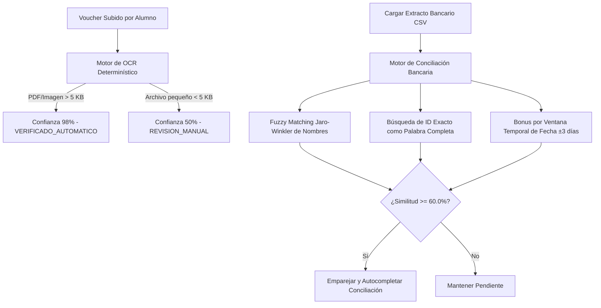

# Manual de Administración (Gestión Máster y Auditoría)

Este bloque documenta las operaciones privilegiadas del Administrador de la plataforma, enfocadas en la seguridad, control financiero y consistencia física de base de datos.

---

## 1. Panel de Control Maestro (Dashboard de Administración)

El administrador cuenta con una consola integrada para supervisar y parametrizar todo el sistema de la comunidad.

---

## 2. Control de Usuarios y Roles (RBAC)

1. Dirígete a `/admin` y selecciona la pestaña **Usuarios** (o ruta `/dashboard/users`).
2. Visualizarás la cuadrícula interactiva con la nómina de la comunidad.
3. **Cambio de Rol:** Selecciona un usuario y utiliza el menú desplegable para reasignar su rol (`ADMIN`, `ORGANIZADOR`, `MODERADOR`, `SOPORTE`, `EMBAJADOR`, `MIEMBRO`).
4. **Estado de Cuenta:** Utiliza el switch para desactivar o activar una cuenta en vivo, inhabilitando accesos de inmediato.

---

## 3. Validación de Pagos y Conciliación OCR

La plataforma gestiona los depósitos bancarios de los alumnos combinando visión artificial y reglas de negocio:

### Verificación Manual de Solicitudes
1. Dirígete al panel `/gestion-pagos`.
2. Se listarán los depósitos subidos por los estudiantes.
3. Al hacer clic sobre una fila, la interfaz de Fluent UI v9 desplegará:
   * La **Imagen Física del Comprobante (Voucher)** a la izquierda.
   * Los **Metadatos Extraídos por OCR** (monto, ID de transacción, fecha) a la derecha.
4. Puedes presionar **Aprobar Depósito** (habilitando la matrícula automática al LMS o evento) o **Rechazar Depósito** (solicitando que el alumno vuelva a cargar el voucher).

### Conciliación Bancaria Difusa en Lote
1. Para validar masivamente las transacciones contra la cuenta bancaria de la comunidad, solicita el archivo **CSV de extracto mensual** del banco.
2. Haz clic en **Conciliar Extracto CSV** y sube el archivo.
3. El motor de servicios del backend (`ocrm_service.py`):
   * Cruzará las transacciones por montos equivalentes.
   * Calculará la similitud de nombres de estudiantes mediante el algoritmo **Jaro-Winkler** (umbral de tolerancia difusa del 85%).
   * Evaluará la proximidad en fechas de transacción (ventana temporal de ±3 días).
   * Buscará el ID de pago exacto en la glosa del banco (confianza 100%).
4. El sistema mostrará la tabla de conciliados recomendados (> 60% de confianza) para confirmación masiva del administrador.

---

## 4. Bitácora de Auditoría Forense (Logs de Sistema)

Para garantizar la seguridad de la información ante manipulaciones internas:

1. Dirígete a la sección de **Auditoría Forense** (ruta `/auditoria`).
2. Se cargará el visor inalterable de logs transaccionales recopilados en la tabla `logs_sistema`.
3. Cada fila detalla:
   * Marca temporal UTC exacta.
   * IP física del emisor HTTP.
   * Identificador del operador involucrado.
   * Tipo de mutación de datos.
   * Un reporte JSON comparativo (*diff*) contrastando los campos anteriores con los nuevos valores modificados.

---

## 5. Panel de Limpieza Selectiva de Datos (Soft/Hard) con Trazabilidad (MEH-020)

Cuando la base de datos contiene datos reales mezclados con registros de demostración o *seed*, el Administrador dispone de la pestaña **Limpieza de Datos** dentro de `/admin` (habilitada mediante el flag `ENABLE_DATA_CLEANUP=true`).

### Cuentas Protegidas e Intocables
El motor bloquea automáticamente cualquier intento de borrado lógico o físico sobre:
- **Superadmin (`SUPERADMIN_EMAIL`):** Cuenta protegida por correo electrónico (por defecto `natalygemio@gmail.com`).
- **Administrador en Sesión:** El operador autenticado que ejecuta la limpieza nunca puede auto-eliminarse.
- **Lista Blanca Configurable:** Correos adicionales registrados dinámicamente en el panel (`CLEANUP_PROTECTED_EMAILS`).
- **Configuración Interna:** Claves críticas del módulo en `configuracion_global`.

### Flujo de Peligro Progresivo en 4 Pasos
1. **Paso 1 — Catálogo, Presets y Protegidos:**
   - Selecciona un preset integrado (como **"Dejar solo superadmin"**, **"Limpiar datos de Seed / Demo"** o **"Limpiar lotes de prueba OCR"**) o guarda tus propios presets personalizados.
   - Gestiona la lista blanca de correos protegidos y marca las tablas del catálogo que deseas inspeccionar.
2. **Paso 2 — Selección por Registro y Origen:**
   - Inspecciona fila por fila cada tabla seleccionada.
   - Visualiza la trazabilidad de origen de cada registro: **Clasificación (`SEED`, `REAL`, `OCR`)**, **Creador**, **Fecha de creación** y **Entidad Padre**.
   - Los registros protegidos aparecen bloqueados con la insignia `PROTEGIDO`.
3. **Paso 3 — Previsualización, Dependencias y Respaldo Obligatorio:**
   - Elige el modo de operación:
     - **Soft Delete (Por defecto):** Marca `id_estado = 4` y desactiva cuentas (`activo = False`). Los registros pueden restaurarse desde la **Papelera**.
     - **Hard Delete (Irreversible):** Elimina físicamente los registros en orden topológico hoja → raíz.
   - Revisa la matriz de dependencias FK calculada y el hash criptográfico de selección (`selection_hash`).
   - Genera y descarga el **Respaldo JSON obligatorio** (almacenado fuera de `/static` en `backend/backups/cleanup/` con vigencia TTL de **30 minutos**).
4. **Paso 4 — Confirmación Extra y Ejecución Atómica:**
   - Ingresa el **motivo de auditoría**, la **frase exacta de confirmación** (`ELIMINAR DATOS` para Soft Delete o `BORRADO DEFINITIVO` para Hard Delete) y tu **contraseña actual de administrador**.
   - En modo Hard Delete se exige marcar la casilla adicional de destrucción irreversible.
   - La ejecución corre dentro de una **transacción atómica única**: ante cualquier error de integridad se aplica *rollback* total. Al finalizar, se registra un log forense en `logs_sistema` con snapshots de los registros afectados que sobrevive incluso cuando se limpia la propia tabla `logs_sistema`.
